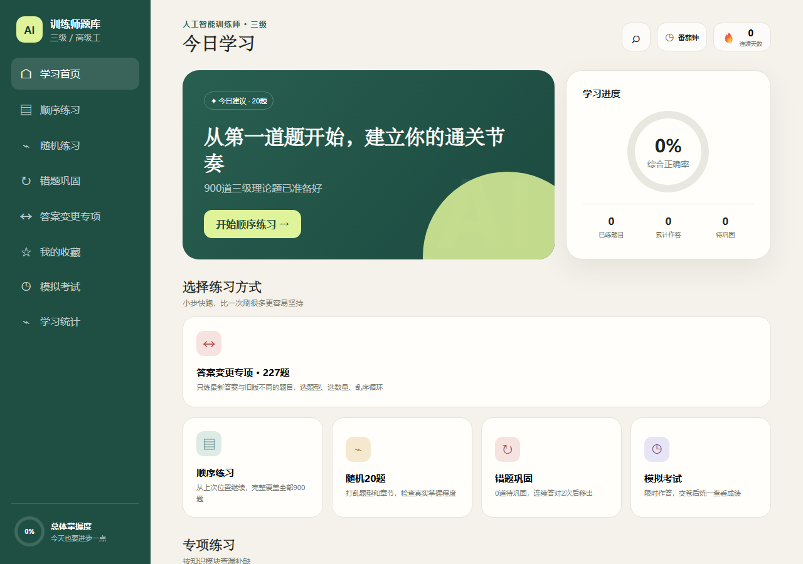
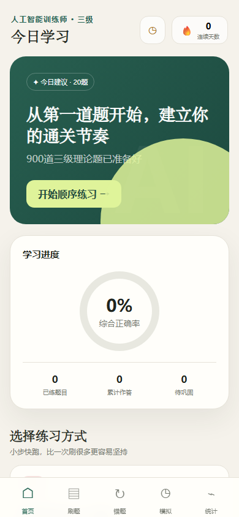

# AI 训练师三级刷题站

一个面向「人工智能训练师（三级 / 高级工）」考试的响应式刷题 Web App。电脑、手机、iPad 用同一套网页，可添加到主屏幕、可离线刷题；登录后还能跨设备同步进度。

**开箱即用**：下载后双击 `index.html` 就能开始刷题，不需要安装任何东西；想用完整 PWA / 离线能力，再双击 `start.bat`（有 Node.js 或 Python 时自动起本地服务器）。

> An offline-first PWA quiz app for China's "AI Trainer (Level 3)" exam. 900 questions, wrong-answer book, mock exams, pomodoro timer, and optional Supabase sync. Local-first: works with zero setup.




## 快速开始

| 方式 | 步骤 | 得到什么 |
| --- | --- | --- |
| 最简单 | 双击 `index.html` | 完整刷题功能，记录保存在本机浏览器 |
| 完整 PWA | 双击 `start.bat`，浏览器访问 `http://127.0.0.1:8000` | 可离线、可“添加到主屏幕” |
| 手动起服务 | `node server.js` 或 `python server.py` | 同上，端口可用 `PORT` 环境变量改 |
| 在线版 | 打开 GitHub Pages 地址 | 手机直接访问，无需电脑 |

> 说明：`file://` 下 Service Worker 不会注册，所以“离线缓存 / 添加到主屏幕”需要 `start.bat` 或在线版。

## 功能

- **900 道三级理论客观题**：判断 300、单选 300、多选 300。
- 顺序练习、随机 20 题、按知识模块专项练习，题型可任意组合。
- **答案变更专项**：只练与旧版答案不同的 227 道题。
- 错题本：累计错误次数，连续答对 2 次后标记已巩固。
- 收藏、题库搜索、学习统计、模拟考试（限时、交卷统一评分）。
- 25/5、45/10、60/10 及自定义番茄钟。
- 响应式布局，手机 / iPad / 电脑共用一套页面。
- PWA 离线缓存 + 添加到主屏幕。
- 学习记录 JSON 导入 / 导出。
- **云同步（可选，默认关闭）**：Supabase 邮箱认证 + 同步密码，多设备合并进度；不配置时自动进入纯本地模式，界面不会出现登录入口。

## 云同步怎么开（可选）

默认 `config.js` 里是空字符串，应用就是纯本地模式。要开启同步：

1. 注册 [Supabase](https://supabase.com/)，新建项目。
2. 按 [`docs/sql/supabase_setup.sql`](docs/sql/supabase_setup.sql) 建表并开启 RLS。
3. 把 `Project Settings → API` 里的 URL 和 publishable key 填进 `config.js`。
4. 重新部署 / 刷新页面。

`publishableKey` 是设计上可公开的前端 key，真正的保护来自数据库 RLS 规则；不要填 `service_role` key。

## 项目结构

```text
ai-trainer-level3-quiz/
├─ index.html              页面骨架与弹窗
├─ styles.css              响应式样式
├─ app.js                  刷题、统计、番茄钟、本地存储
├─ config.js               云同步配置（默认留空 = 纯本地）
├─ supabase.js             Supabase 登录与 REST 同步客户端
├─ questions.js            900 道题库
├─ service-worker.js       PWA 离线缓存
├─ manifest.webmanifest    PWA 元数据
├─ server.js / server.py   零依赖本地静态服务器
├─ start.bat               Windows 一键启动
├─ docs/                   设计、部署、测试等文档与截图
├─ tests/                  UI 冒烟测试
├─ tools/                  题库构建、校验、发布脚本
├─ CONTENT-NOTICE.md       题库内容版权说明
└─ LICENSE                 MIT（仅覆盖代码）
```

## 校验与发布

```powershell
python tools\validate_project.py   # 静态校验（需 Python）
python tests\smoke_ui.py           # UI 冒烟测试（需 Playwright + Edge）
python tools\build_release.py      # 生成 Cloudflare 发布包
```

## 部署

- **GitHub Pages**：仓库 Settings → Pages → 选择 `main` 分支根目录，几分钟后即可访问。所有资源都是静态文件，没有构建步骤。
- **Cloudflare Workers / Pages、Netlify、Vercel**：直接上传仓库即可。
- **Supabase**：见上面的可选步骤。

## 题库与版权（重要）

- 代码以 [MIT](LICENSE) 许可发布。
- **题库内容来自公开考试复习材料，版权归原始权利人**，不属于 MIT 授权范围，详见 [CONTENT-NOTICE.md](CONTENT-NOTICE.md)。
- 原始材料本身存在缺题、缺题干等问题；网页忠实保留来源内容，不擅自编造，也不代表答案经过官方逐题复核。
- 如果你想换成自己的题库，替换 `questions.js` 即可（格式见文件首行），或使用 `tools/import_latest_answers.py` 重新导入。

## English

An offline-first PWA for practicing China's AI Trainer Level-3 exam: 900 multiple-choice questions, sequenced/random/topic practice, wrong-answer book, favorites, mock exams, pomodoro timer, JSON import/export, and optional Supabase sync. Runs from a single double-click, no build step. Code is MIT; question content belongs to its original source (see CONTENT-NOTICE.md).

---

祝考试顺利。如果这个项目帮到了你，欢迎点个 ⭐。
