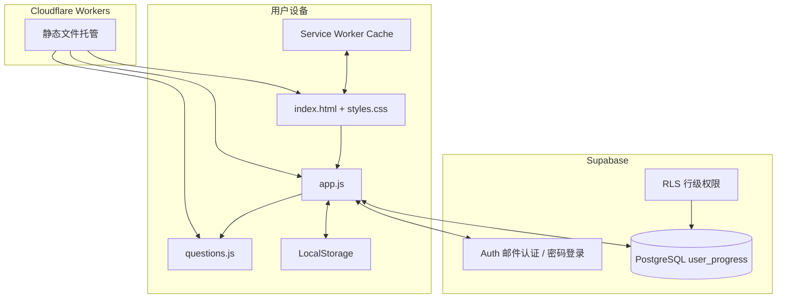

# 系统架构

## 1. 总览

系统采用“静态前端 + 浏览器本地状态 + 云端认证数据库”的结构。



## 2. 前端模块

### `index.html`

负责固定页面结构：侧边栏、顶部栏、主要内容容器、搜索/考试/登录/题型/番茄钟弹窗和脚本加载顺序。

### `styles.css`

负责颜色变量、卡片、题目状态、响应式断点和移动端底部导航。主要断点为 `760px` 和 `1050px`。

### `questions.js`

在全局暴露 `window.QUESTION_BANK`。静态题库随站点一起缓存，不需要每次从数据库下载。

### `app.js`

负责：

- 路由式视图渲染；
- 作答与判分；
- 错题、收藏和统计；
- 模拟考试；
- 题型筛选；
- 番茄钟；
- 本地存储；
- 云端合并和同步。

### `supabase.js`

使用 Supabase 的公开 REST/Auth 接口，不依赖 npm 包。负责首次邮件认证、密码登录与设置、会话保存、Token 刷新、拉取和推送 `user_progress`。

### `service-worker.js`

- 安装时缓存应用外壳和题库。
- HTML 导航联网优先，失败时回退缓存。
- 静态资源联网优先，失败时回退缓存。
- `skipWaiting()` 和 `clients.claim()` 让新缓存尽快接管。

## 3. 数据流

### 作答

```text
点击选项
  → 本地判分
  → 更新内存 state
  → 写入 localStorage
  → 约 900ms 防抖
  → 若已登录且联网，合并并上传 Supabase
```

### 登录

```text
输入邮箱
  → Supabase 发送 Magic Link
  → 用户点击 Sign in
  → 回到站点并携带 access_token / refresh_token
  → 前端保存会话
  → 拉取云端进度
  → 与本地进度合并
  → 将合并结果回写云端
```

首次认证后，用户可设置题库专用同步密码。其他设备可通过邮箱和该密码直接换取会话，后续同步流程相同。

### 离线

```text
Service Worker 提供页面和题库
  → 作答只写 localStorage
  → 恢复网络或产生下一次作答
  → 自动尝试同步
```

## 4. 托管边界

- Cloudflare 只托管公开静态文件，不保存学习进度。
- Supabase 保存账号和进度 JSON，不保存题库。
- 浏览器本地保存离线副本和登录会话。

## 5. 无构建依赖的原因

项目规模较小，采用原生技术能降低部署复杂度：

- 不需要 Node.js 构建服务器。
- 发布包可直接上传。
- 更适合个人长期维护。
- 离线调试和迁移更简单。

代价是 `app.js` 目前为单文件业务逻辑，功能继续扩大时应拆分模块。
